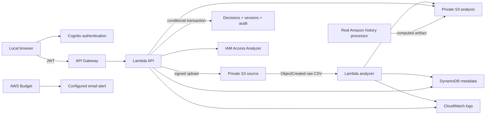

# Architecture

Local FastAPI uses the same service, ingestion, governance and analysis modules as Lambda. SQLite stores source grants and cached version artifacts; WAL and explicit transactions protect local updates.

AWS stores source and effective analyses in separate S3 objects. DynamoDB maintains current version/pointer, immutable version records, review decisions, and actor audit events. A conditional transaction updates all relevant rows together only when the expected version matches. A conflicting request returns HTTP 409. S3 writes preceding a failed transaction can leave an unreferenced artifact, which expires under the results lifecycle.

Source analysis is never edited by a permission decision. An approved removal computes a new effective policy from original grants minus approved removals. All source users and permission identifiers remain in the known universe even when a subject has no effective grants. A restore can grant only a pair present in the original source. Authorization evaluates the selected mined role memberships.

Worker processing is idempotent for a completed dataset ID. Signed browser uploads use SigV4, a five-minute URL, signed metadata and a conditional write. Strict input validation rejects malformed data; a failed parse is recorded and shown. The demo bounds input at 25 MiB and 500,000 distinct grants. A failed infrastructure operation remains a real failure and is logged.

The UI requests compact analytics and paginated catalogs; it does not manufacture recommendations in cloud mode. All review and authorization operations call the real backend. JSON exports contain application RBAC labels, not invented AWS actions. The protected validation route accepts an actual IAM policy document.

Cognito public sign-up is disabled. API Gateway validates the JWT; Lambda also requires authorizer claims. Actor identity comes from the authenticated subject, never a submitted actor field. S3 is private/encrypted. CORS is restricted to the local UI origin. The local API binds to loopback and rejects foreign browser origins.

The historical experiment is intentionally separate: actual Amazon add/remove events and authorization delays feed temporal profiles and terminal Q-learning. It has a chronological holdout and a support mask. It neither joins unrelated user populations nor changes the active permission policy.

This demo uses application authorization, not an ERP connector or AWS principal provisioning. Account CloudTrail management history is AWS account evidence, not an ERP event source. No paid analyzer, CloudTrail data-event trail, Neptune or always-running compute is created.
